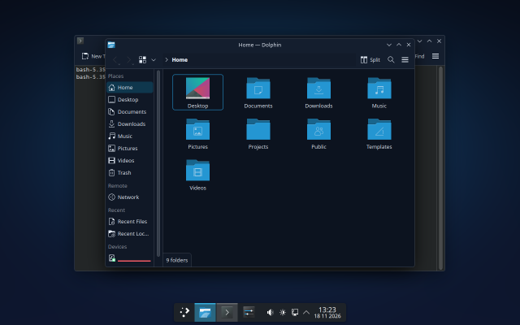
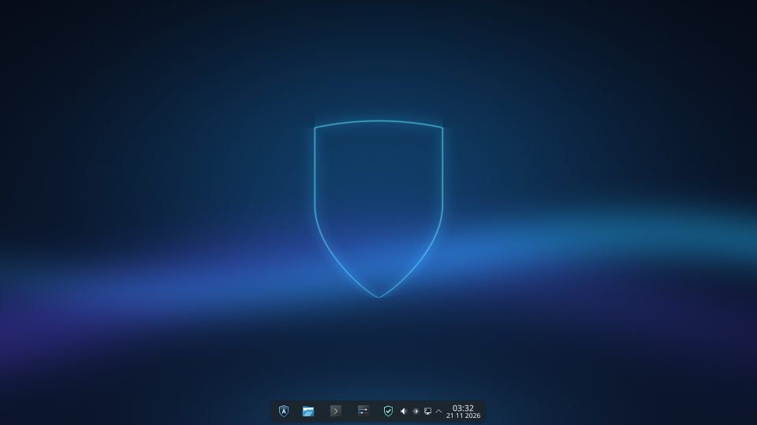
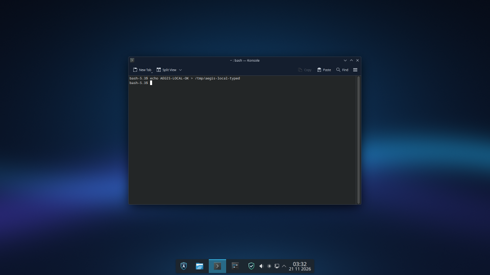
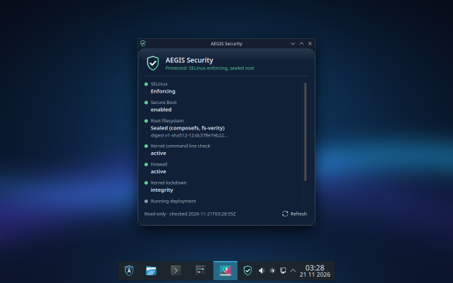
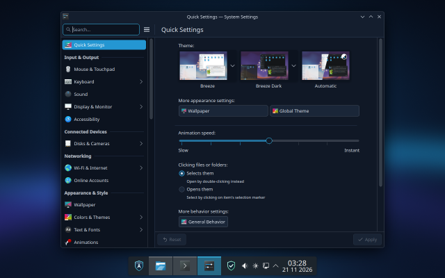

# AEGIS OS graphical desktop: architecture (GUI v1)

Status: GUI v1 on branch `claude/aegis-os-gui-v1`, which merges the security branch
(M4 signed updates and rollback, M5 locked inputs and reproducibility) into the M4-GUI
foundation. Results are recorded in `PROJECT_STATE.md` ("GUI v1 track") only once a CI
run has shown them. The M4-GUI foundation's results (run 44315378122) are history.

## Decision

AEGIS builds its desktop on **KDE Plasma 6 with KWin as the Wayland compositor**, Qt 6 /
QML, and KDE Kirigami. AEGIS-specific work starts as configuration and branding of
Plasma (look-and-feel package, colour scheme, wallpaper, default layout), then grows into
AEGIS applications and Plasma components written in QML/Kirigami.

| Option | Why not (now) |
|---|---|
| Own compositor | Multi-year effort; the blueprint excludes it (Phase 4 builds on an existing compositor) |
| GNOME / Mutter | Extension model is less suited to an AEGIS shell; Qt/QML is the chosen UI toolkit |
| Quickshell on KWin | A second shell in the same session would compete with plasmashell for panels, layers and input. Reserved for a later, separate evaluation; never run alongside plasmashell |
| wlroots-based compositor + own shell | Loses Plasma's mature settings, accessibility, portals, multi-monitor and input handling |

Plasma 6 gives, without new privileged code: a Wayland compositor with SELinux-labelled
processes, portals (`xdg-desktop-portal-kde`), NetworkManager and PipeWire integration,
System Settings, and a scripting API for default layouts.

## Image

`aegis-gui` is a variant of the **development** image (it keeps the development SSH
server so tests can reach it). It is built by `image/Containerfile.gui` from the
development root filesystem and then sealed by `scripts/seal-image` exactly like the
other variants: signed systemd-boot and UKI, composefs root with fs-verity, the sealed
command-line check, SELinux enforcing. Nothing in the boot chain differs.

Added packages (Fedora 45, no weak dependencies, about 500 packages and 1 GiB):
Plasma desktop and workspace, KWin, Breeze, SDDM with its Wayland greeter, Konsole,
Dolphin, System Settings, Info Center, KScreen, plasma-nm, plasma-pa, PipeWire with
WirePlumber and the PulseAudio shim, the KDE desktop portal, Qt Declarative and Wayland,
Kirigami, Mesa drivers (software rendering in VMs), Noto Sans.

**Display manager: SDDM, not plasma-login-manager.** Fedora 45's KDE edition moved to
`plasma-login-manager`. SDDM 0.21 is still packaged, and its configuration (including
the test-time autologin drop-in) is documented and stable. To be revisited when the
login screen gets AEGIS branding.

## GUI v1: design system and Liquid Glass foundation

### Design tokens: `org.aegisos.style`

A QML module in the image (`/usr/lib64/qt6/qml/org/aegisos/style`) that every AEGIS
component imports. `Tokens` (singleton) holds colour (graphite, midnight, deep blue,
cyan and silver accents, text, status colours), opacity, blur, radii, spacing,
typography, shadow and motion (durations 120/200/320 ms, ease-out, a mild overshoot only
for expansion). Materials are limited to three: **regular**, **elevated**, **control**.
`GlassSurface` is the one glass primitive; `StatusRow` shows a state with a dot *and*
text, never by colour alone.

### What "glass" is here, and what it is not

| Layer | How it is produced |
|---|---|
| Background-aware translucency and backdrop blur | KWin's own **blur effect** behind translucent panels, popups and windows that request it (`/etc/xdg/kwinrc`: strength 12, noise 2). The dock and Plasma popups request it. |
| Tint, fine light-facing border, inner highlight, soft shadow | `GlassSurface` (plain rectangles and a gradient; no shader passes) |
| Depth and motion | Floating dock, elevated popups, Plasma's own open/close animations; hover feedback through a brighter inner fill (`Tokens.motion.fast`) |

Not provided, and not claimed: refraction, optical distortion, lens or specular
effects, or sampling of the background inside QML. A Qt Quick item cannot read what is
behind its window; only the compositor can, and KWin's public effects offer blur, not
refraction. A custom KWin effect would be the place for that and needs a design note
first (sealed image, GPU budget, software fallback).

Fallbacks: `Tokens.reducedTransparency` is on under Qt Quick's software renderer and
gives every material an opaque equivalent with the same contrast; `Tokens.duration()`
returns 0 when motion is reduced. KWin itself turns blur off when the compositor cannot
run it. In a VM without 3D (the CI and the default launcher) everything runs on llvmpipe
(software OpenGL): blur works, at a CPU cost that is measured (idle CPU in
`PROJECT_STATE.md`).

### Components

| Component | GUI v1 state |
|---|---|
| Dock | Plasma panel configured as the AEGIS dock: floating, centred, fit to content, translucent with blur; AEGIS mark on the launcher; pinned Files, Terminal, Settings with running indicators and window activation (icon task manager); AEGIS Security; tray; clock |
| Launcher | Kickoff (application discovery, search, keyboard navigation) with the AEGIS mark. No AEGIS-written launcher yet |
| Settings | KDE System Settings (display, network, sound, appearance, users) |
| Control Center | Plasma system tray (network, volume, power and brightness where the hardware has it). No AEGIS control panel yet |
| Security Dashboard v0 | `org.aegisos.security` Plasma widget, read-only: SELinux mode, Secure Boot, sealed root and digest, command-line check, firewall, lockdown, running image. Data from `/usr/libexec/aegis/security-status`, run as the desktop user; update state needs root (`bootc status`) and is shown as unavailable rather than guessed |
| On-screen keyboard | Installed, not started (`/etc/xdg/kwinrc` `InputMethod` empty); can be enabled in System Settings |

### Downloadable image and launcher

`scripts/export-qcow2 --gui` packages the tested disk as `aegis-os-gui-*.qcow2` with
`run-aegis-gui-vm.sh`, `LOCAL_GUI_VM_GUIDE.md`, `IMAGE-INFO.txt` and `SHA256SUMS`
(artifact `aegis-os-gui-qcow2`). The launcher gives the VM only the image file
(refuses devices, directories and non-qcow2 files), virtio-vga at 1920x1080 (or
`--gl` virtio-vga-gl, untested), USB keyboard and tablet, HDA sound through the host's
PulseAudio/PipeWire, user-mode networking with SSH on loopback, snapshot mode, and OVMF
**without Secure Boot keys** (the local VM does not verify the boot chain; CI does).
The login is created at first boot from systemd credentials: user `aegis`, uid 1000, in
`wheel`, random password generated on the host and kept next to the image, only its
SHA-512 crypt hash passed to the VM. The image itself contains no user.

## Configuration placement (ADR-0014)

| Item | Location |
|---|---|
| Look-and-feel package `org.aegisos.desktop` (defaults, layout script) | `/usr/share/plasma/look-and-feel/` |
| Colour scheme `AEGISDark` | `/usr/share/color-schemes/` |
| Wallpaper `AEGIS` (generated by `scripts/make-wallpaper`) | `/usr/share/wallpapers/` |
| Display-manager preset | `/usr/lib/systemd/system-preset/03-aegis-gui.preset` |
| Selecting the look-and-feel for all users | `/etc/xdg/kdeglobals` (`[KDE] LookAndFeelPackage`), the one `/etc` file this variant adds; Plasma reads defaults only from XDG config dirs |
| Default target `graphical.target`, display-manager link | `/etc/systemd/system` (written by `systemctl`) |

## Desktop layout (first iteration)

One floating panel, centred at the bottom, as wide as its content: launcher (Kickoff),
pinned Files, Terminal and Settings, task manager, system tray, clock. This is the
foundation for the AEGIS dock: its position, floating and fit-to-content behaviour are
the dock's; its contents are standard Plasma applets until AEGIS components replace them.

## Planned components and where they will live

| Component | Approach | Privileges |
|---|---|---|
| Floating dock | Plasma panel configuration first; later an AEGIS QML applet | None (user session) |
| Launcher | Kickoff first; later an AEGIS QML applet | None |
| Control Center | Kirigami application, System Settings modules (KCMs) where possible | Changes go through polkit-authorised D-Bus services of the system, never a privileged GUI process |
| Security dashboard | Kirigami application showing Secure Boot, sealed root, SELinux, firewall, update state | Read-only data: `/sys`, `bootc status --json` through a narrowly scoped, polkit-protected D-Bus service (to be designed); no root UI |
| Custom settings | KCMs and KConfig defaults in `/usr/share` | Same as Control Center |

Rule: no GUI component runs as root. A component that must change system state talks
to a dedicated D-Bus service whose methods are authorised by polkit and confined by its
own SELinux domain. Each such service needs a design note before it is written.

## Testing

`tests/vm/test_gui.py` (job `gui` in the build workflow) boots the sealed GUI image under
Secure Boot with a virtio GPU, USB keyboard and tablet and an HDA sound card. The test
user and SDDM autologin are created at boot from systemd credentials passed by the
harness (`sysusers.extra`, `tmpfiles.extra`), the same channel as the developer SSH key;
the image contains no user. The test checks the Wayland session, keyboard input (a
command typed into Konsole must run), Dolphin and System Settings, pointer input,
networking, audio devices, the security properties (Secure Boot, SELinux enforcing with
no denials, sealed root, command-line check), resource use, restart and clean power-off.
Screenshots are taken through QMP and printed, half size, into the job log.

The M3 Secure Boot and sealed-root tests (`tests/vm/test_secure_boot.py`) also run
against the GUI image in the same job.

## Results of the first image (CI runs 44312306345 and 44315378122)

Rendered under Secure Boot in a KVM virtual machine (virtio-vga, software rendering,
1280x800), screenshots taken through QMP and inspected:

| Desktop | Konsole with the typed test command |
|---|---|
|  |  |
| **Dolphin** | **System Settings (AEGIS Dark colours)** |
|  |  |
| **Right click on the desktop (pointer test)** | |
|  | |

Observed: AEGIS wallpaper and colour scheme applied; floating, centred, content-sized
panel with launcher, pinned Files/Terminal/Settings, tray and clock; legible text, no
clipping, no error dialogs. Measurements are in `PROJECT_STATE.md`.

## GUI v1 results (`build` run 44860719246 on `1aa082e`)

All 31 GUI tests pass (21 on the harness VM under Secure Boot, 10 on the exported QCOW2
started with `run-aegis-gui-vm.sh`). Rendered in CI with software rendering, screenshots
recovered from the job log and inspected:

| Exported image, 1920x1080, via the Linux launcher | Konsole: command typed on the virtual keyboard |
|---|---|
|  |  |
| **AEGIS Security Dashboard v0** | **System Settings** |
|  |  |

Observed: AEGIS wallpaper with tonal depth; floating dock with the AEGIS launcher mark,
pinned applications with a running indicator, the AEGIS Security shield, tray and clock;
the dashboard shows the true state of the machine (SELinux Enforcing, Secure Boot
enabled, sealed composefs root with its digest, command-line check active, firewall
active, lockdown integrity), the deployment and a read-only footer. Defects found by
inspection and fixed on the way: dashboard showed only its icon (run 44749833133);
dashboard clipped its last rows (run 44751864651).

## Known limitations (GUI v1)

- Software rendering only (llvmpipe in a VM; the launcher's `--gl` path is untested).
  Frame times are not measured: KWin offers no stable interface for them that runs in
  CI, so animation smoothness is not verified beyond screenshots.
- Glass is blur plus tint, border, highlight and shadow; no refraction (see above).
- The dock is a configured Plasma panel; there is no AEGIS-written dock applet, launcher
  or control center yet. The Security Dashboard is the first AEGIS QML component.
- The dashboard cannot show update state or the deployment list: `bootc status` needs
  root, and the read-only D-Bus service that would provide it is not designed yet.
- Dolphin's "Devices" shows the read-only composefs root as a full volume (cosmetic).
- XWayland runs for compatibility; no X11 session is offered.
- The GUI image is not covered by golden manifests (packages, units, `/etc`); its `/etc`
  changes are `/etc/xdg/kdeglobals`, `/etc/xdg/kwinrc` and the display-manager links.
- SDDM shows the stock Breeze login screen when autologin is off; no AEGIS branding.
- The development login is created by the launcher (or the test harness); there is no
  first-boot user setup flow.
- The local VM has no Secure Boot keys, so nothing verifies the boot chain there.

## Next GUI tasks, in order

1. Golden manifests for `aegis-gui` (packages, units, `/etc`), like base and dev.
2. Design note and implementation: read-only, polkit-guarded D-Bus service for
   `bootc status` (deployments, staged update), then show it in the dashboard.
3. AEGIS dock applet (QML, on `org.aegisos.style`) replacing the icon task manager;
   AEGIS launcher after it.
4. AEGIS SDDM / plasma-login-manager theme; decide between the two.
5. GPU path: test `--gl` (virtio-vga-gl) and record frame timing with KWin's debug
   output where available; then decide whether a custom KWin effect is justified.
6. Visual regression baseline: keep reference screenshots per resolution and compare
   them in CI (perceptual difference, not byte equality).
