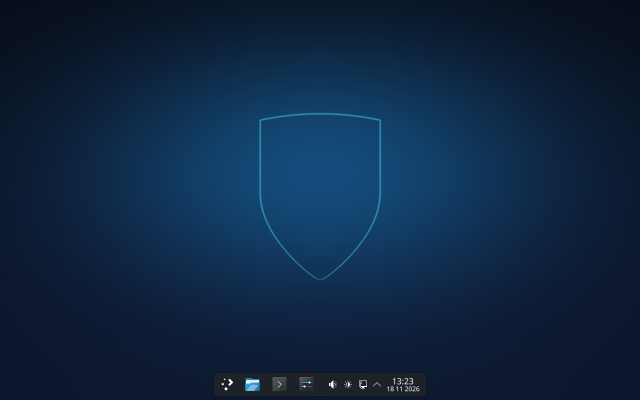
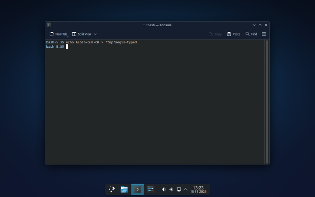
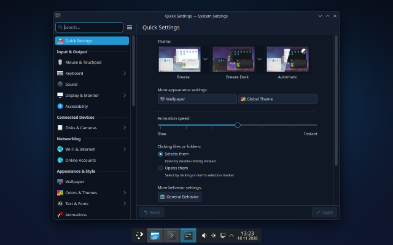
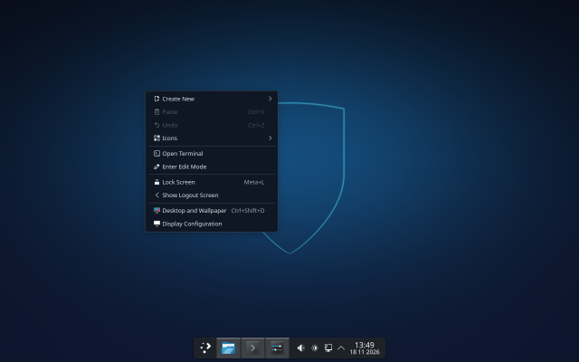

# AEGIS OS graphical desktop: architecture (M4-GUI foundation)

Status: first functional graphical image on branch `claude/aegis-os-gui-foundation`
(CI run 44315378122 on `aa805e4`: 9 of 9 GUI tests and 8 of 8 Secure Boot tests on the
GUI image). The
security milestone M4 (signed updates, manual rollback, gate G1) is **not** complete and
is not affected by this track. Results are recorded in `PROJECT_STATE.md` only once a CI
run has shown them.

## Decision

AEGIS builds its desktop on **KDE Plasma 6 with KWin as the Wayland compositor**, Qt 6 /
QML, and KDE Kirigami. AEGIS-specific work starts as configuration and branding of
Plasma (look-and-feel package, colour scheme, wallpaper, default layout), then grows into
AEGIS applications and Plasma components written in QML/Kirigami.

| Option | Why not (now) |
|---|---|
| Own compositor | Multi-year effort; the blueprint excludes it (Phase 4 builds on an existing compositor) |
| GNOME / Mutter | Extension model is less suited to an AEGIS shell; Qt/QML is the chosen UI toolkit |
| Quickshell on KWin | A second shell in the same session would compete with plasmashell for panels, layers and input. Reserved for a later, separate evaluation; never run alongside plasmashell |
| wlroots-based compositor + own shell | Loses Plasma's mature settings, accessibility, portals, multi-monitor and input handling |

Plasma 6 gives, without new privileged code: a Wayland compositor with SELinux-labelled
processes, portals (`xdg-desktop-portal-kde`), NetworkManager and PipeWire integration,
System Settings, and a scripting API for default layouts.

## Image

`aegis-gui` is a variant of the **development** image (it keeps the development SSH
server so tests can reach it). It is built by `image/Containerfile.gui` from the
development root filesystem and then sealed by `scripts/seal-image` exactly like the
other variants: signed systemd-boot and UKI, composefs root with fs-verity, the sealed
command-line check, SELinux enforcing. Nothing in the boot chain differs.

Added packages (Fedora 45, no weak dependencies, about 500 packages and 1 GiB):
Plasma desktop and workspace, KWin, Breeze, SDDM with its Wayland greeter, Konsole,
Dolphin, System Settings, Info Center, KScreen, plasma-nm, plasma-pa, PipeWire with
WirePlumber and the PulseAudio shim, the KDE desktop portal, Qt Declarative and Wayland,
Kirigami, Mesa drivers (software rendering in VMs), Noto Sans.

**Display manager: SDDM, not plasma-login-manager.** Fedora 45's KDE edition moved to
`plasma-login-manager`. SDDM 0.21 is still packaged, and its configuration (including
the test-time autologin drop-in) is documented and stable. To be revisited when the
login screen gets AEGIS branding.

## Configuration placement (ADR-0014)

| Item | Location |
|---|---|
| Look-and-feel package `org.aegisos.desktop` (defaults, layout script) | `/usr/share/plasma/look-and-feel/` |
| Colour scheme `AEGISDark` | `/usr/share/color-schemes/` |
| Wallpaper `AEGIS` (generated by `scripts/make-wallpaper`) | `/usr/share/wallpapers/` |
| Display-manager preset | `/usr/lib/systemd/system-preset/03-aegis-gui.preset` |
| Selecting the look-and-feel for all users | `/etc/xdg/kdeglobals` (`[KDE] LookAndFeelPackage`), the one `/etc` file this variant adds; Plasma reads defaults only from XDG config dirs |
| Default target `graphical.target`, display-manager link | `/etc/systemd/system` (written by `systemctl`) |

## Desktop layout (first iteration)

One floating panel, centred at the bottom, as wide as its content: launcher (Kickoff),
pinned Files, Terminal and Settings, task manager, system tray, clock. This is the
foundation for the AEGIS dock: its position, floating and fit-to-content behaviour are
the dock's; its contents are standard Plasma applets until AEGIS components replace them.

## Planned components and where they will live

| Component | Approach | Privileges |
|---|---|---|
| Floating dock | Plasma panel configuration first; later an AEGIS QML applet | None (user session) |
| Launcher | Kickoff first; later an AEGIS QML applet | None |
| Control Center | Kirigami application, System Settings modules (KCMs) where possible | Changes go through polkit-authorised D-Bus services of the system, never a privileged GUI process |
| Security dashboard | Kirigami application showing Secure Boot, sealed root, SELinux, firewall, update state | Read-only data: `/sys`, `bootc status --json` through a narrowly scoped, polkit-protected D-Bus service (to be designed); no root UI |
| Custom settings | KCMs and KConfig defaults in `/usr/share` | Same as Control Center |

Rule: no GUI component runs as root. A component that must change system state talks
to a dedicated D-Bus service whose methods are authorised by polkit and confined by its
own SELinux domain. Each such service needs a design note before it is written.

## Testing

`tests/vm/test_gui.py` (job `gui` in the build workflow) boots the sealed GUI image under
Secure Boot with a virtio GPU, USB keyboard and tablet and an HDA sound card. The test
user and SDDM autologin are created at boot from systemd credentials passed by the
harness (`sysusers.extra`, `tmpfiles.extra`), the same channel as the developer SSH key;
the image contains no user. The test checks the Wayland session, keyboard input (a
command typed into Konsole must run), Dolphin and System Settings, pointer input,
networking, audio devices, the security properties (Secure Boot, SELinux enforcing with
no denials, sealed root, command-line check), resource use, restart and clean power-off.
Screenshots are taken through QMP and printed, half size, into the job log.

The M3 Secure Boot and sealed-root tests (`tests/vm/test_secure_boot.py`) also run
against the GUI image in the same job.

## Results of the first image (CI runs 44312306345 and 44315378122)

Rendered under Secure Boot in a KVM virtual machine (virtio-vga, software rendering,
1280x800), screenshots taken through QMP and inspected:

| Desktop | Konsole with the typed test command |
|---|---|
|  |  |
| **Dolphin** | **System Settings (AEGIS Dark colours)** |
|  |  |
| **Right click on the desktop (pointer test)** | |
|  | |

Observed: AEGIS wallpaper and colour scheme applied; floating, centred, content-sized
panel with launcher, pinned Files/Terminal/Settings, tray and clock; legible text, no
clipping, no error dialogs. Measurements are in `PROJECT_STATE.md`.

## Known limitations

- Software rendering only (llvmpipe in a VM); no GPU acceleration, frame times not
  measured yet.
- The launcher button shows the generic start icon, not an AEGIS mark.
- Dolphin's "Devices" shows one volume with a full (red) usage bar, most likely the
  read-only composefs root reporting itself as full. Cosmetic; to be hidden or labelled.
- `plasma-keyboard` (on-screen keyboard) runs and uses about 266 MB; it is not needed
  on this image.
- XWayland runs for compatibility; no X11 session is offered.
- The GUI image is not yet covered by golden manifests (packages, units, `/etc`).
- SDDM shows the stock Breeze login screen when autologin is off; no AEGIS branding.
- Only one test user, created at boot by the test harness; there is no user setup flow.

## Next GUI tasks, in order

1. Golden manifests for `aegis-gui` (packages, units, `/etc`), like base and dev.
2. Remove or disable the on-screen keyboard; measure memory again.
3. AEGIS mark for the launcher button and the SDDM theme; hide the composefs root in
   Dolphin's Places.
4. Frame-time measurement (KWin's FPS/latency output) on the software renderer, as the
   baseline for the Phase 4 frame-time budget.
5. AEGIS QML design tokens module (colours, spacing, radii, motion) shared by future
   components (`aegis-ui-designer`, `aegis-qt-developer` skills).
6. Security dashboard v0: read-only Kirigami application showing Secure Boot, sealed
   root, SELinux and lockdown state from `/sys`; design note for the D-Bus service that
   later exposes `bootc status`.
7. Dock v1: an AEGIS QML applet replacing the task manager in the floating panel.
8. Decide plasma-login-manager versus SDDM once the login screen is branded.
